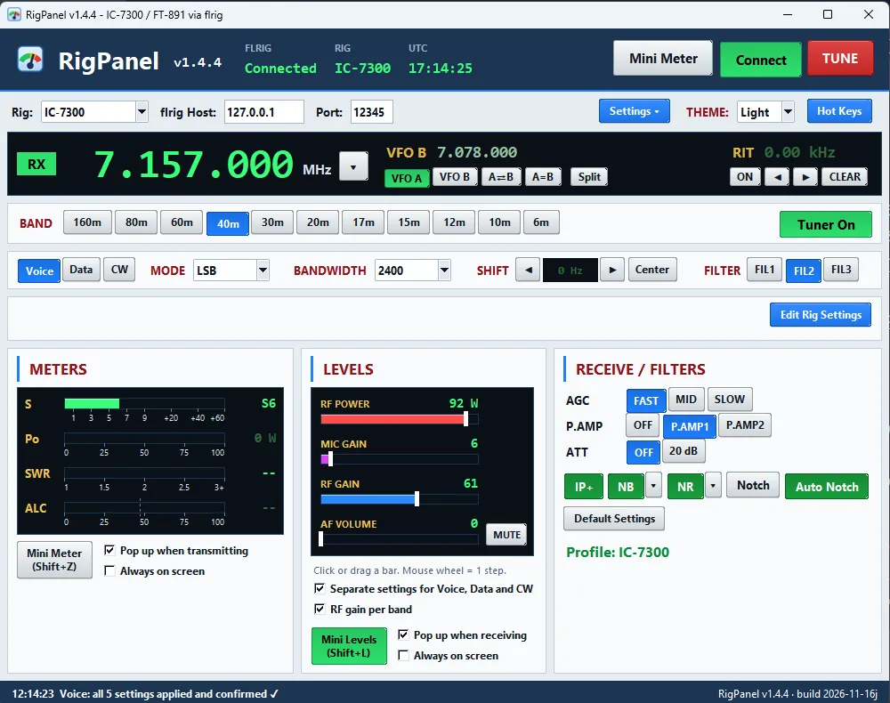
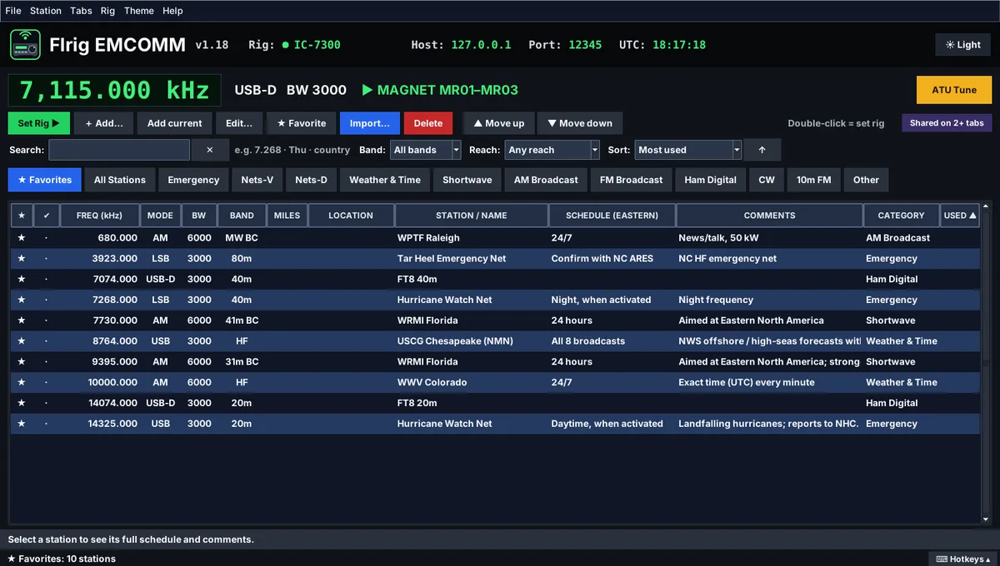
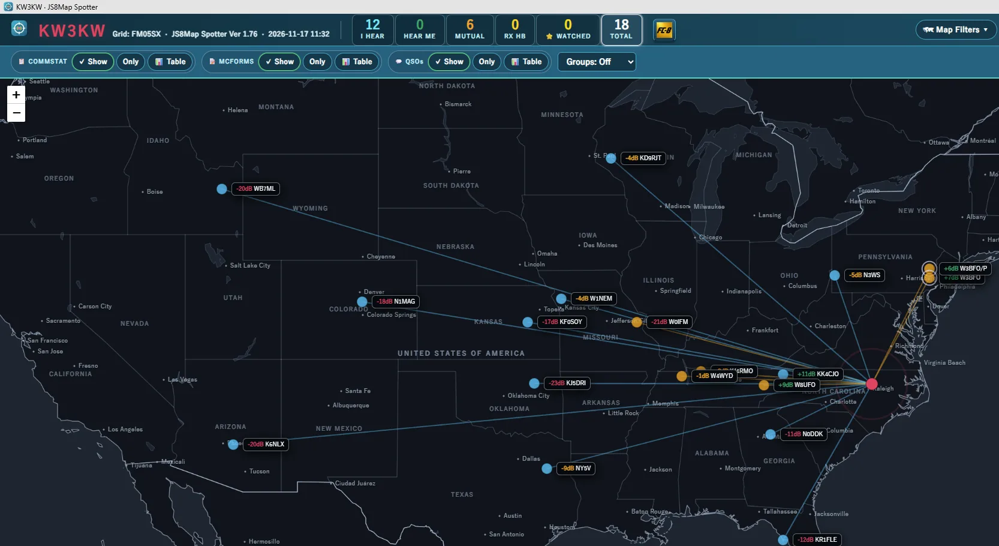

# Ham Radio Made Simple · KW3KW

**Free ham radio software for Windows and Linux** — rig control through flrig, a station list
that tunes your radio, live JS8Call maps and chat, an offline callsign lookup, and a launcher that opens them all
in order with one click.
Made by KW3KW of the [Ham Radio Made Simple](https://www.youtube.com/@hamradiomadesimple)
YouTube channel, for hams who want things to just work.

🌐 **Website:** [hamradiomadesimple.github.io](https://hamradiomadesimple.github.io/) &nbsp;·&nbsp;
▶️ **YouTube:** [@hamradiomadesimple](https://www.youtube.com/@hamradiomadesimple)

## The apps

Every download is free. The **Download** link always gets the newest version.

| App | What it does | Works with | Get it |
|---|---|---|---|
| **[RigPanel](https://github.com/HamRadioMadeSimple/RigPanel)** | Control your IC-7300 or FT-891 from one screen: tune, bands, split, meters, one-click Voice / Data / CW setups | flrig | [Download](https://github.com/HamRadioMadeSimple/RigPanel/releases/latest) · [Guides](https://github.com/HamRadioMadeSimple/RigPanel/tree/main/docs) |
| **[Flrig EMCOMM](https://github.com/HamRadioMadeSimple/Flrig-EMCOMM)** | A station list that tunes your radio: nets, emergency, weather, shortwave, digital and CW — double-click and go | flrig | [Download](https://github.com/HamRadioMadeSimple/Flrig-EMCOMM/releases/latest) · [Guides](https://github.com/HamRadioMadeSimple/Flrig-EMCOMM/tree/main/docs) |
| **[JS8Map Spotter](https://github.com/HamRadioMadeSimple/JS8MapSpotter)** | Every station JS8Call hears on a live, offline map, with StatReps, MCForms and alerts on top | JS8Call | [Download](https://github.com/HamRadioMadeSimple/JS8MapSpotter/releases/latest) |
| **[JS8MapChat](https://github.com/HamRadioMadeSimple/JS8MapChat)** | JS8Map plus JS8FastChat, a compact chat window for working one station | JS8Call | [Download](https://github.com/HamRadioMadeSimple/JS8MapChat/releases/latest) |
| **[FCC Lookup](https://github.com/HamRadioMadeSimple/FCC_Lookup)** | Offline callsign lookup for the U.S. and Canada, with distance and bearing | — | [Download](https://github.com/HamRadioMadeSimple/FCC_Lookup/releases) |
| **[DigiApp Launcher](https://github.com/HamRadioMadeSimple/DigiApp-Launcher)** | Opens your digital-mode programs in order, waiting between each one, from one click on the taskbar or panel; Close Open Apps shuts them down in reverse | flrig, JS8Call, Fldigi, WSJT-X and the apps above | [Download](https://github.com/HamRadioMadeSimple/DigiApp-Launcher/releases/latest) · [Guides](https://github.com/HamRadioMadeSimple/DigiApp-Launcher/tree/main/docs) |

  
  

  

## Getting help

- **Start with the guide:** each app has a Quick Start or install guide (PDF) on its GitHub page.
- **Found a problem?** Open an issue on that app's page (the **Issues** tab). Say which radio,
  which app version, and Windows or Linux.
- **Videos:** step-by-step walkthroughs on [YouTube](https://www.youtube.com/@hamradiomadesimple).

All apps are free and open source (GNU GPL; DigiApp Launcher uses the MIT license).
flrig is by W1HKJ and the fldigi team; JS8Call is by KN4CRD. These apps are independent and work alongside them.

73 de KW3KW
